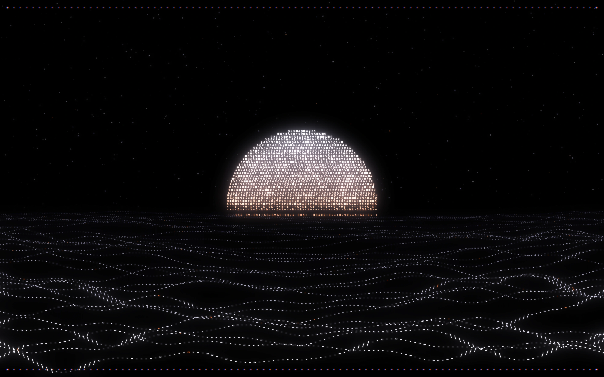
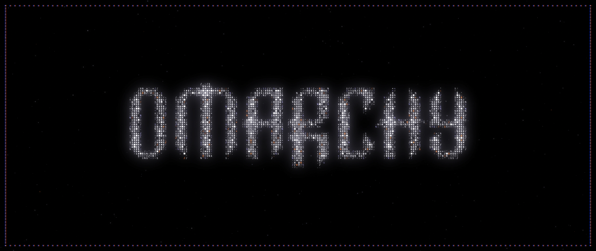
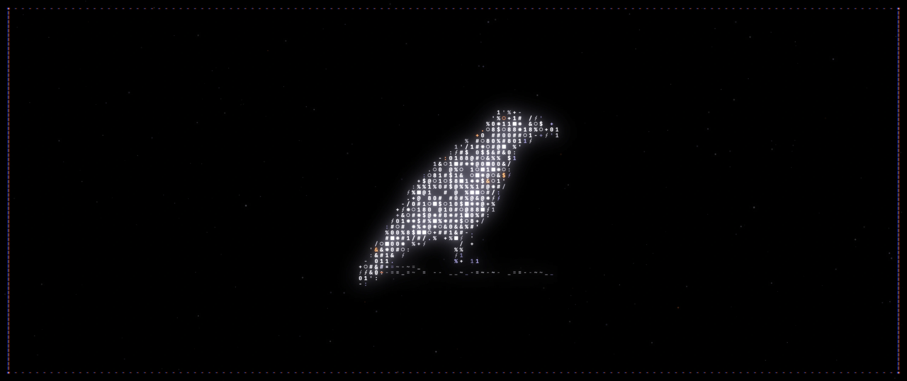
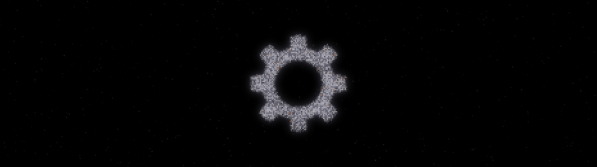
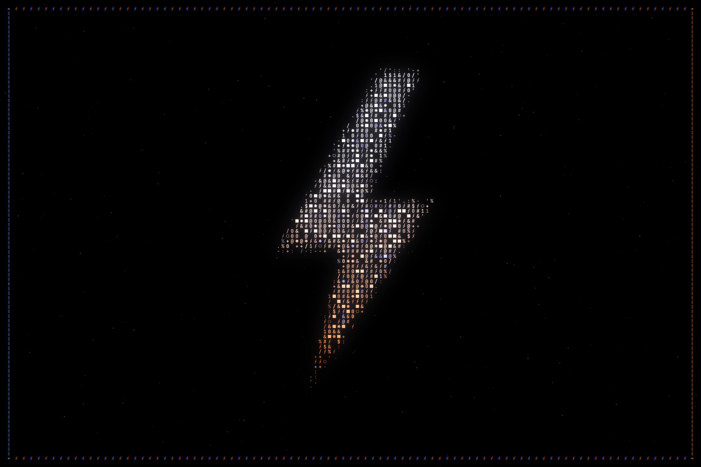
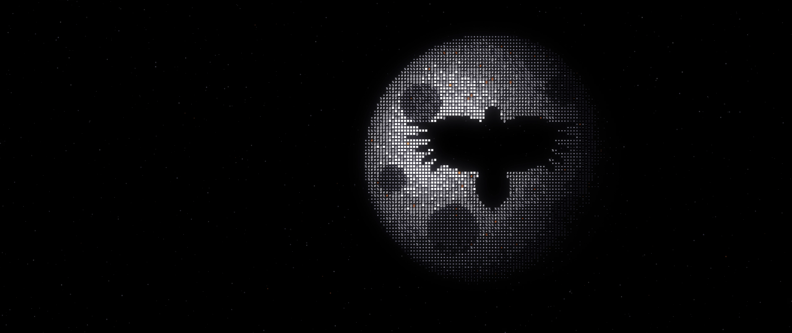
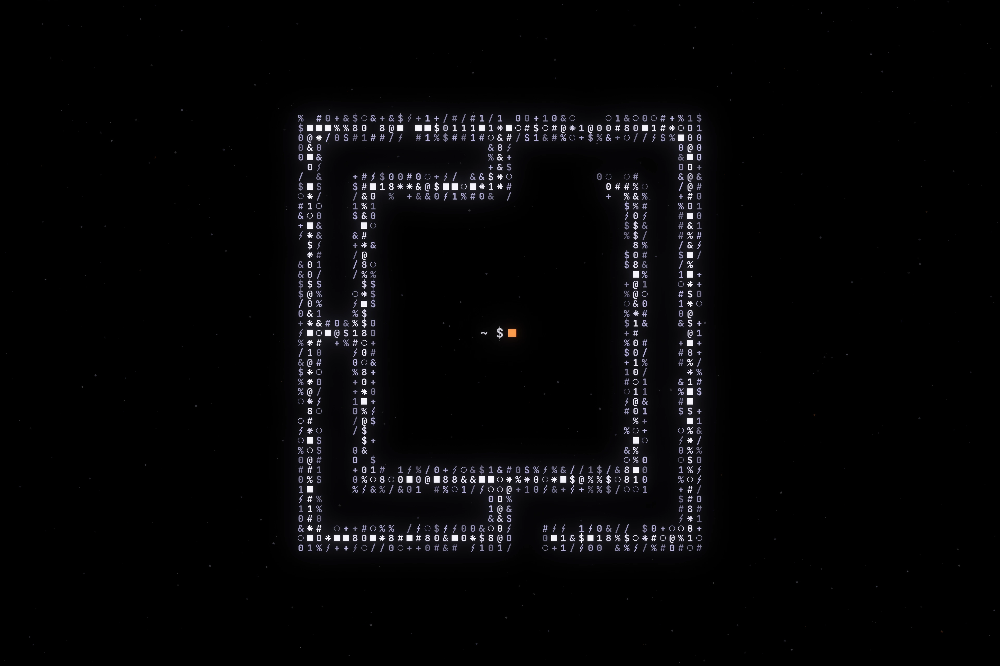
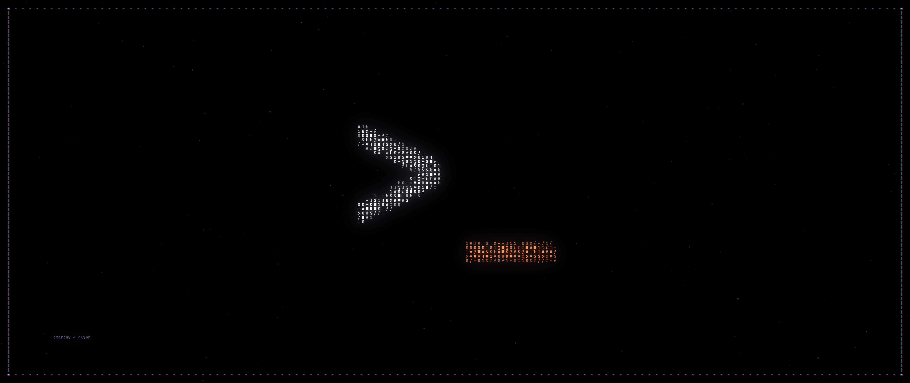
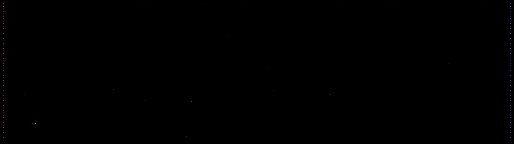

# Glyph

An [Omarchy](https://omarchy.org) theme where everything is drawn in characters.
White phosphor glyphs glow on a black sky, with a soft lavender bloom, chromatic-fringed
frames and the odd orange ember.


## Install

From the Omarchy menu: **Install → Theme**, then paste:

```
https://github.com/kylekanderson/omarchy-glyph-theme
```

Or from a terminal:

```bash
omarchy-theme-install https://github.com/kylekanderson/omarchy-glyph-theme
```

### Ultrawide, super-ultrawide or 3:2 screen?

Omarchy fills every monitor with the same image and crops what doesn't fit, so the
16:9 wallpapers lose their top and bottom on a 21:9 screen. Glyph has a complete set
rendered natively for each common shape. After installing, run:

```bash
~/.config/omarchy/themes/glyph/bin/fit-backgrounds
```

It looks at your largest monitor, switches the theme to the matching set and
re-applies it. To choose a shape yourself, run `fit-backgrounds 21x9`, or
`fit-backgrounds --list` to see the options:

| shape | rendered at | for |
|---|---|---|
| `16x9` | 5120×2880 | most monitors (the default) |
| `16x10` | 3840×2400 | many laptops |
| `3x2` | 3840×2560 | Framework 13, Surface |
| `21x9` | 5120×2160 | 3440×1440, 3840×1600, 5K2K ultrawides |
| `32x9` | 7680×2160 | super-ultrawides (5120×1440, 7680×2160) |

Each shape lives on its own branch of this repo, so `omarchy theme update` keeps that
shape up to date and the background rotation only ever shows one set. To go back,
run `fit-backgrounds 16x9`.

With monitors of different shapes, pick the one you look at most. Omarchy can only show
one image across all screens.

## Wallpapers

Nine wallpapers, all rendered from monospace glyphs. Cycle them with
<kbd>Super</kbd> + <kbd>Ctrl</kbd> + <kbd>Space</kbd>.

| | |
|---|---|
|  **01 · horizon**: ridgelines of dashes under a banded sun |  **02 · omarchy**: the wordmark, four glyphs per pixel |
|  **03 · perch**: a raven on a branch, framed |  **04 · cog**: an eight-tooth cog of round glyphs |
|  **05 · bolt**: white-hot at the top, orange at the strike |  **06 · nocturne**: a raven cut out of a glyph moon |
|  **07 · mark**: the Omarchy mark with a prompt inside |  **08 · prompt**: `>_`, drawn with hundreds of characters |
|  **09 · void**: a frame and a cursor, for busy desktops | |

The theme also ships an `unlock.png` (a glyph-drawn `>_`) for the lock and boot screens
(**Style → Unlock** in the Omarchy menu).

## Palette

| role | hex | | role | hex |
|---|---|---|---|---|
| background | `#08080a` | | accent / orange | `#f0763a` |
| foreground | `#d8d6e4` | | blue | `#8b9cff` |
| bright foreground | `#f4f2ff` | | magenta | `#c49bff` |
| red | `#ff6b5e` | | cyan | `#8ad4e6` |
| yellow | `#f4b860` | | green | `#8fd6b0` |

Everything else (terminals, Hyprland, Waybar, Walker, Mako, btop, Neovim and more) is
generated by Omarchy from [`colors.toml`](colors.toml).

## Regenerating the art

All images are generated by [`src/generate.py`](src/generate.py) from the shapes in
[`src/shapes.py`](src/shapes.py) and the masks in [`src/art`](src/art). You need
[uv](https://docs.astral.sh/uv/) and JetBrains Mono (set `GLYPH_FONT=/path/to/font.ttf`
if it isn't found).

```bash
uv run src/generate.py                       # all wallpapers + unlock + previews
uv run src/generate.py --only cog            # one wallpaper
uv run src/generate.py --size 3840x2160      # another resolution
uv run src/generate.py --fast --out /tmp/x   # quick drafts while tweaking
```

Layouts adapt to any aspect ratio. After changing the art on `main`, rebuild and push
the per-shape branches with:

```bash
src/build-variants.sh --push
```

Glyphs are picked by distance from a shape's edge (light `. : + - / ϟ` at the rim,
dense `@ # 0 ■ ✱` in the core), then lit with three blur passes and a red/blue-shifted
frame for the chromatic fringe.

## Credits

Inspired by the glyph art on Framework's [Laptop 13 Pro](https://frame.work/laptop13pro)
page. The cog, bolt and ravens are original shapes, not Framework's artwork or logo.

The Omarchy wordmark and mark in `src/art` are traced from
[Omarchy](https://github.com/basecamp/omarchy)'s `logo.svg` and `icon.png`,
© David Heinemeier Hansson, used under the MIT license (see
[`src/art/OMARCHY-LICENSE`](src/art/OMARCHY-LICENSE)).

Everything else is MIT licensed.
