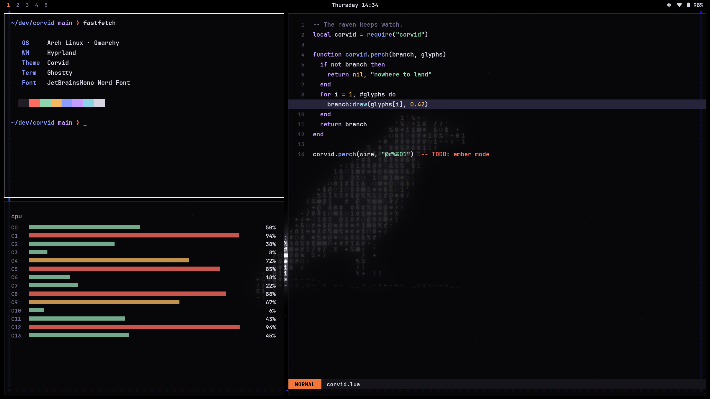
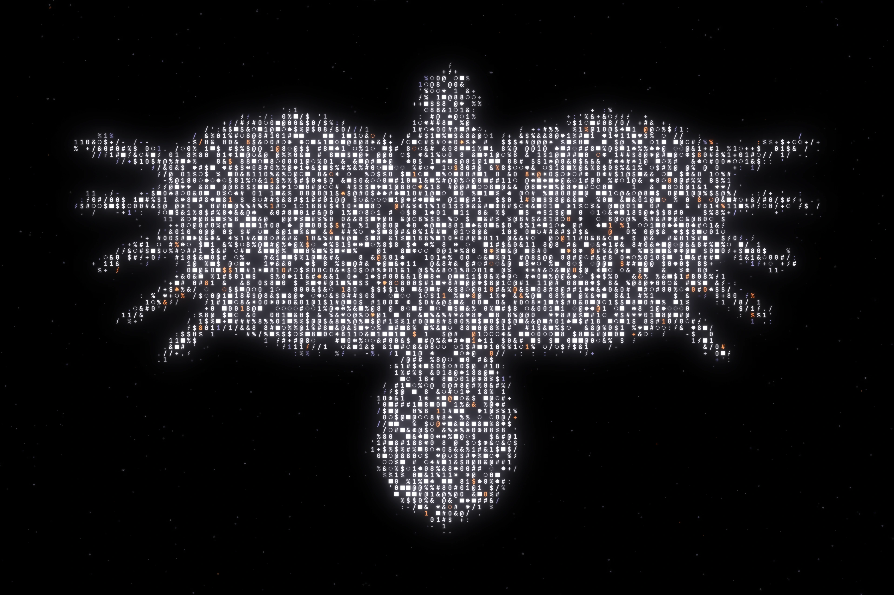
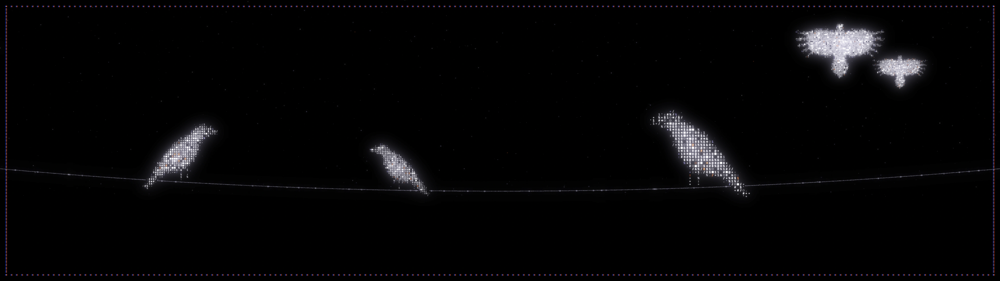
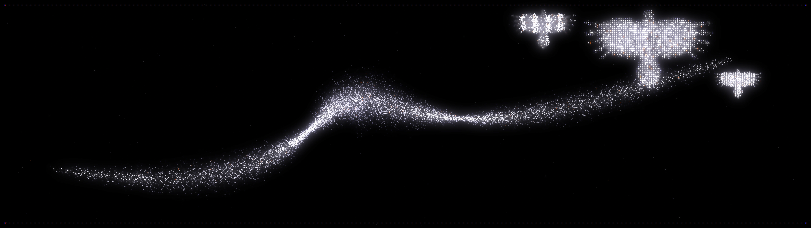
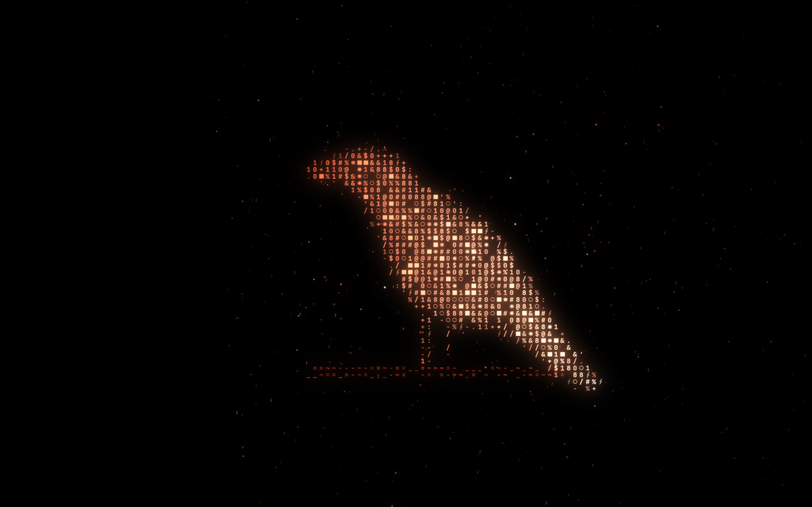
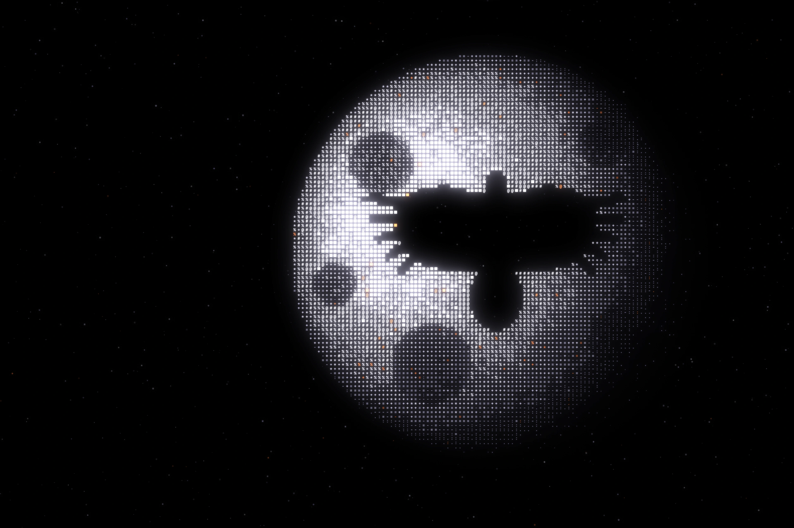
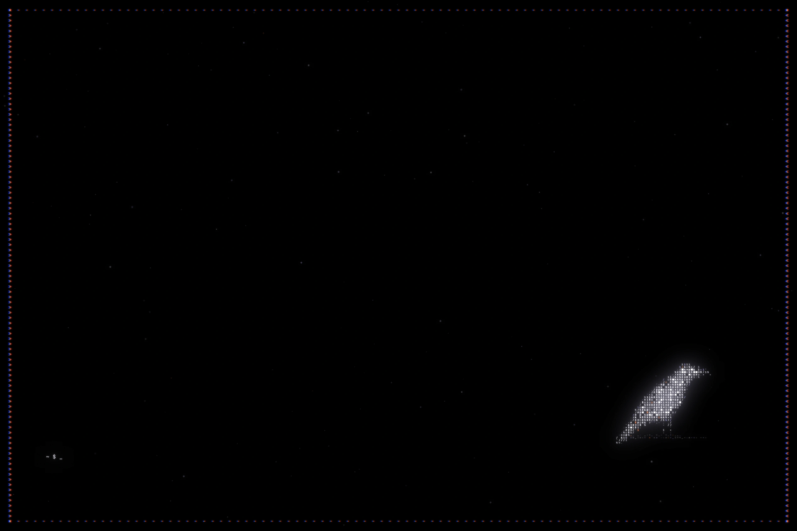

# Corvid

An [Omarchy](https://omarchy.org) theme of ravens built from glowing ASCII glyphs on a black sky.
White phosphor text, a soft lavender bloom, a chromatic-fringed frame and the odd orange ember.



## Install

From the Omarchy menu: **Install → Theme**, then paste:

```
https://github.com/kylekanderson/omarchy-corvid-theme
```

Or from a terminal:

```bash
omarchy-theme-install https://github.com/kylekanderson/omarchy-corvid-theme
```

## Wallpapers

Seven 5120×2880 wallpapers, all rendered from monospace glyphs. Cycle them with
<kbd>Super</kbd> + <kbd>Ctrl</kbd> + <kbd>Space</kbd>.

| | |
|---|---|
|  **1 · perch**: the raven, framed |  **2 · glide**: wings across the whole screen |
|  **3 · wire**: three on a line, two leaving |  **4 · murmuration**: a flock of fourteen thousand `v`s |
|  **5 · ember**: white-hot to deep red, with sparks |  **6 · nocturne**: a raven cut out of a glyph moon |
|  **7 · void**: mostly nothing, for busy desktops | |

The theme also ships an `unlock.png`, so the raven can be your lock/boot logo
(**Style → Unlock** in the Omarchy menu).

## Palette

| role | hex | | role | hex |
|---|---|---|---|---|
| background | `#08080a` | | accent / orange | `#f0763a` |
| foreground | `#d8d6e4` | | blue | `#8b9cff` |
| bright foreground | `#f4f2ff` | | magenta | `#c49bff` |
| red | `#ff6b5e` | | cyan | `#8ad4e6` |
| yellow | `#f4b860` | | green | `#8fd6b0` |

Everything else (terminals, Hyprland, Waybar, Walker, Mako, btop, Neovim and more) is
generated by Omarchy from [`colors.toml`](colors.toml).

## Regenerating the art

All images are generated by [`src/generate.py`](src/generate.py) from the hand-drawn
silhouettes in [`src/shapes.py`](src/shapes.py). You need [uv](https://docs.astral.sh/uv/)
and JetBrains Mono (set `CORVID_FONT=/path/to/font.ttf` if it isn't found).

```bash
uv run src/generate.py                       # all wallpapers + unlock + previews
uv run src/generate.py --only nocturne       # one wallpaper
uv run src/generate.py --size 3840x2160      # another resolution
uv run src/generate.py --fast --out /tmp/x   # quick drafts while tweaking
```

Glyphs are picked by distance from a silhouette's edge (light `. : + - / ϟ` at the rim,
dense `@ # 0 ■ ✱` in the core), then lit with three blur passes and a red/blue-shifted
frame for the chromatic fringe.

## Credits

Inspired by the glyph art on Framework's [Laptop 13 Pro](https://frame.work/laptop13pro)
page. All imagery here is original and generated from code.

MIT licensed.
